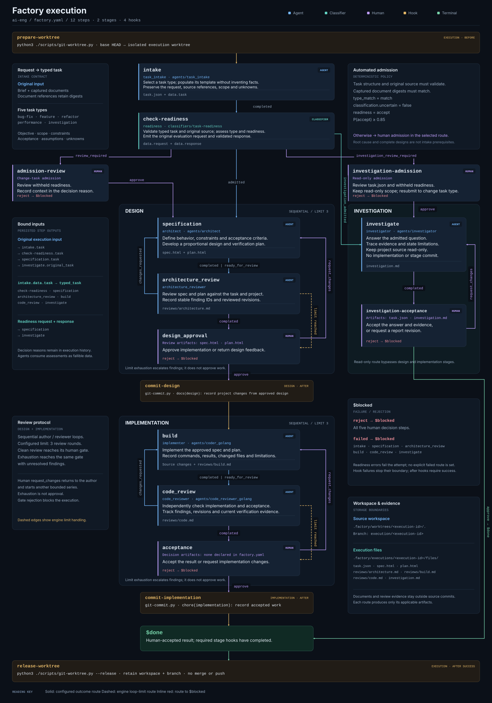

# ai-eng

### An engineering process agents can run and people can inspect.


Turn a request into a typed task, a reviewed design, and an implementation backed by evidence. Configure the language, models, and tools around that process.

**[Install and run](#local-factory)** · **[Read the design](AI%20Software%20Engineering%20Stack.md)** · **[Factory master diagram](ai-eng-stack.svg)** · **[PNG](ai-eng-stack.png)**

## Factory workflow



[Open SVG](ai-eng-stack.svg) · [Download PNG](ai-eng-stack.png) · [factory.yaml](factory.yaml)

Intake uses [five task templates](skills/task-intake/SKILL.md): bug fix, feature, refactor, performance, and investigation. Investigations produce a read-only report for human acceptance. The full workflow records rejection, repair, escalation, and human decisions. Each review stage allows up to three rounds before escalation.

## The execution contract

```text
AGENTS   → investigate · design · build · verify · review
ENGINE   → permissions · routing · limits · durable state
PEOPLE   → admission · design approval · acceptance
```

Bug fixes demonstrate correction. Refactors demonstrate preservation. Performance changes demonstrate measured improvement. Templates make those obligations explicit.

## Local factory

Requires Git, Go, Node.js, and npm. Install Controls and Monitor from `main`:

```sh
./install.sh
export PATH="$HOME/.local/bin:$PATH"
```

Use `./install.sh --prefix /path/to/install` to choose another location. Re-running updates clean `main` checkouts and rebuilds both components.

Define `factory.yaml` in your project using the [configuration reference](https://github.com/PragmaEngineering/factory-controller/blob/main/docs/factory-yaml.md). Install the selected [agents](agents/README.md) with their `install.macos.sh`, then configure credentials before starting the service. The [workflow in this repository](factory.yaml) is one reference configuration.

```sh
factory start
factory monitor start -d
factory exec "Your task" -c /path/to/project/factory.yaml
```

Open the URL printed by Monitor to inspect executions and handle configured decisions. `factory stop --all` stops both services.

## The Pragma toolkit

| Component | Repository | Responsibility |
| --- | --- | --- |
| Runtime | [factory-controller](https://github.com/PragmaEngineering/factory-controller) | Workflow execution, routing, human decisions, and CLI. |
| Operator UI | [factory-monitor](https://github.com/PragmaEngineering/factory-monitor) | Execution graphs, messages, findings, and decisions. |
| Optional delegation | [factory-fabric](https://github.com/PragmaEngineering/factory-fabric) | Capability discovery and asynchronous specialist calls. |

[Reference factory configuration](https://github.com/PragmaEngineering/factory-registry/blob/main/factories/golang/factory.yaml) · [PragmaEngineering](https://github.com/PragmaEngineering)

## The scorecard

**Quality** / Accepted completion · Escaped defects · First-review pass  
**Effort** / Rework · Human involvement  
**Efficiency** / Cycle time · Cost per accepted task

[Definitions and accounting rules](AI%20Software%20Engineering%20Stack.md#proposed-execution-metrics)

---

**Working design.** This repository includes the base factory configuration, agent bundles, skills, classifier, hooks, and diagrams. Typed intake and templates are included; metric collection is being defined. Next: evaluate a bug fix and a feature through the workflow.
