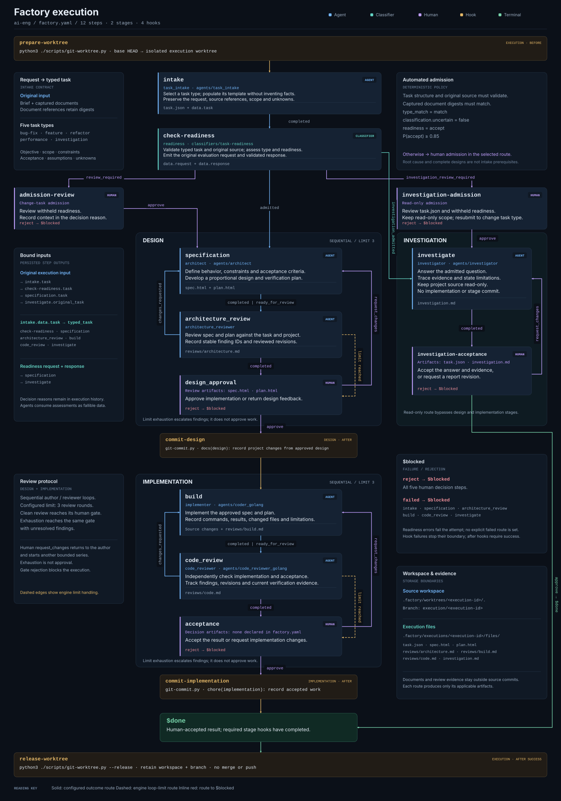

# Agentic SDLC with Factory

[Setup](SETUP.md) · [Design and metrics](design.md) · [Reference configuration](factory.yaml) · [Other scenarios](../../README.md)

Use this scenario when the workflow engine should own routing, bounded execution, durable state, and configured human gates. Factory Controls executes the workflow; Monitor exposes execution and decisions. Fabric can supply discovery and delegation where integrated. It is not required by this reference configuration.



[Open SVG](diagrams/ai-eng-stack.svg) · [Download PNG](diagrams/ai-eng-stack.png) · [Diagram source](diagrams/ai-eng-stack.mmd)

## Workflow

**Request → typed intake → readiness → reviewed design → human approval → implementation and review → human acceptance.**

Intake uses five task types: bug fix, feature, refactor, performance, and investigation. Investigations route to a read-only report and human acceptance. Other tasks pass through design and implementation loops. Each review stage allows up to three rounds before escalation; human requests for changes start another bounded series.

```text
AGENTS   → investigate · design · build · verify · review
ENGINE   → permissions · routing · limits · durable state
PEOPLE   → admission · design approval · acceptance
```

The [design](design.md) defines detailed behavior, task types, failure handling, and proposed metrics. The [configuration](factory.yaml) is the executable reference. Language, provider, model, and verification tooling are configuration choices.

## Runtime resources

| Resource | Purpose |
| --- | --- |
| [agents/](agents/README.md) | Worker packages and macOS installers. |
| [skills/](../../skills/) | Engineering methods and agent-invoked tooling bundled with each skill. |
| [scripts/](scripts/README.md) | Engine-invoked worktree and commit hooks. |
| [Task readiness](classifiers/task-readiness/README.md) | Classifier after typed intake. |

Factory-specific resources live beside factory.yaml. Agent bundles link to the shared root skills; hook guidance is in [skills/](skills/). The local [package manifest](package.json) and lockfile contain only Factory SDK/adapter dependencies.

## Shared supporting skills

Design, implementation, and review bundles expose [project verification](../../skills/project-verification/SKILL.md) and [performance measurement](../../skills/performance-measurement/SKILL.md). Implementation/review and investigation expose [CI diagnostics](../../skills/ci-diagnostics/SKILL.md). Load methods only when the task needs them. Skills do not change routing, stage limits, or human gates; project-local harness authoring, repairs, and external actions still require assignment scope.

## Evaluate the workflow

Track accepted completion, escaped defects, design/code first-review pass, rework, cycle time, cost per accepted task, and human effort. Use the [definitions and accounting rules](design.md#proposed-execution-metrics) and compare similar task types. Metric collection remains proposed; activity and token volume do not establish correctness.
